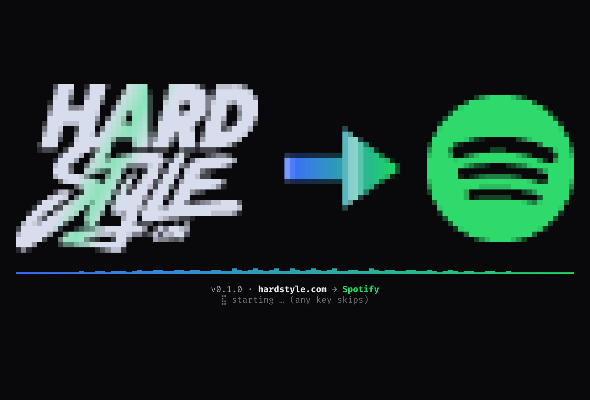
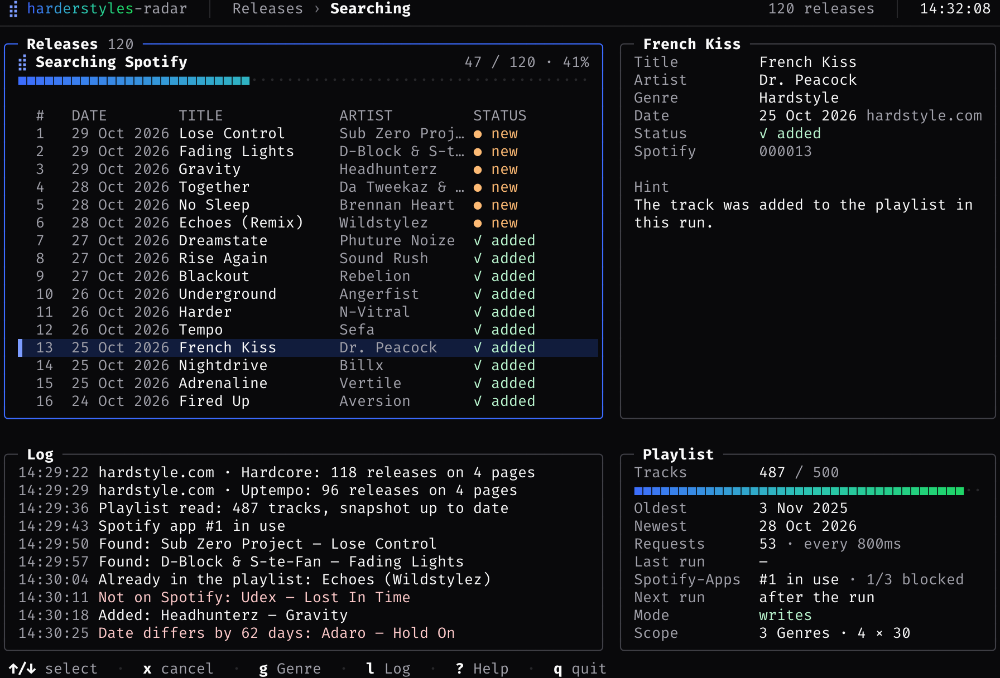
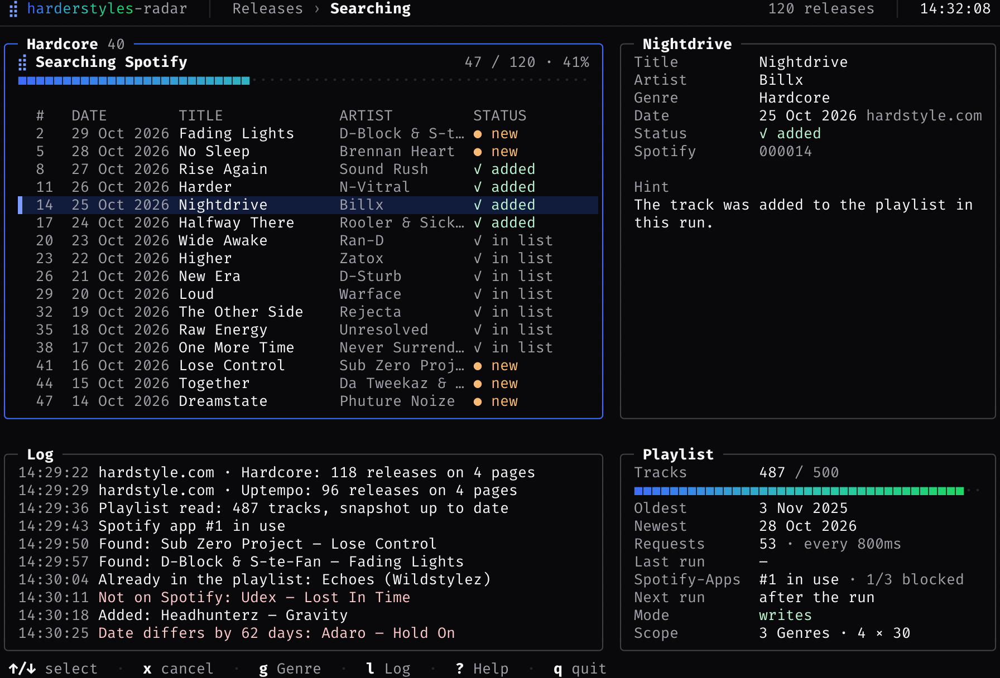
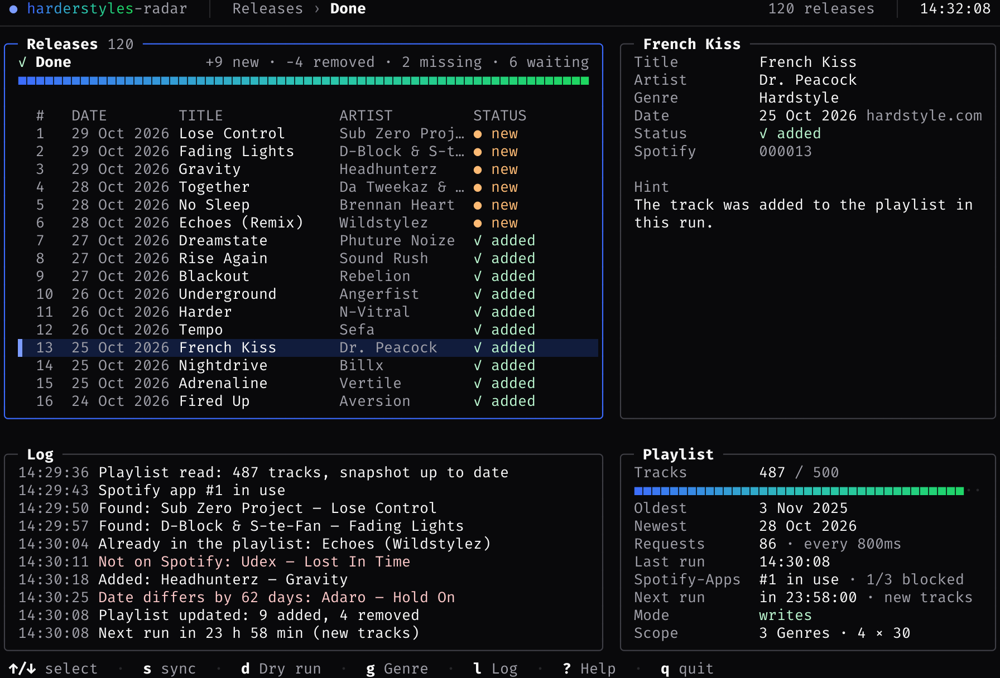
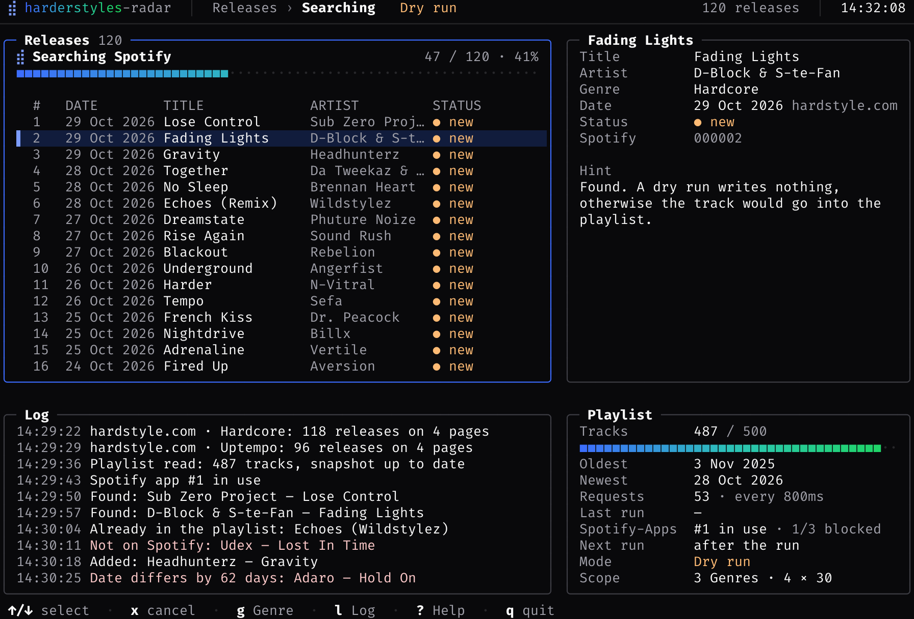
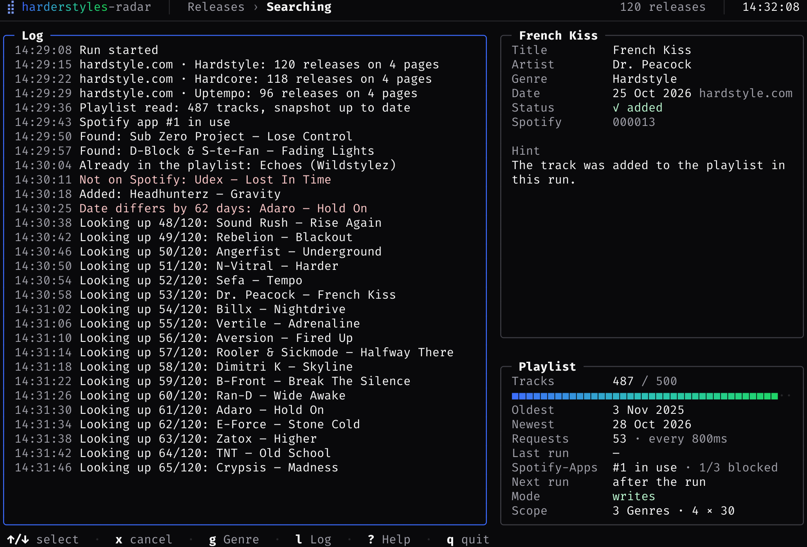
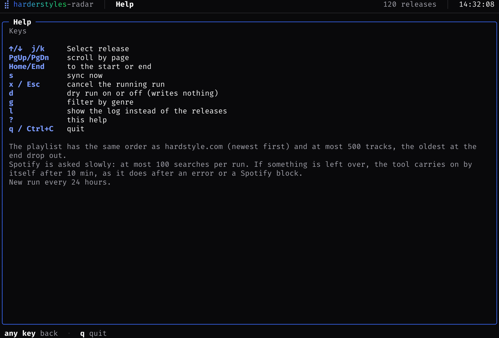
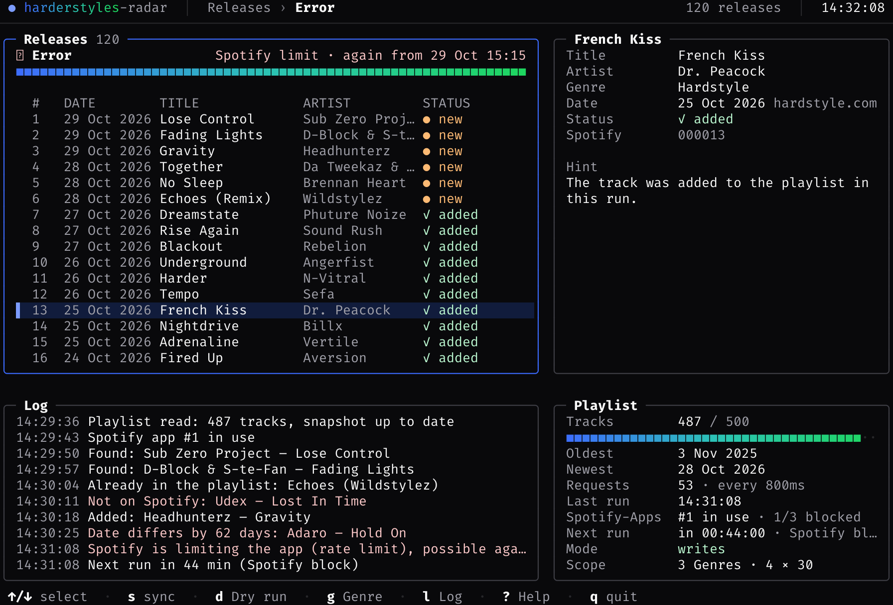
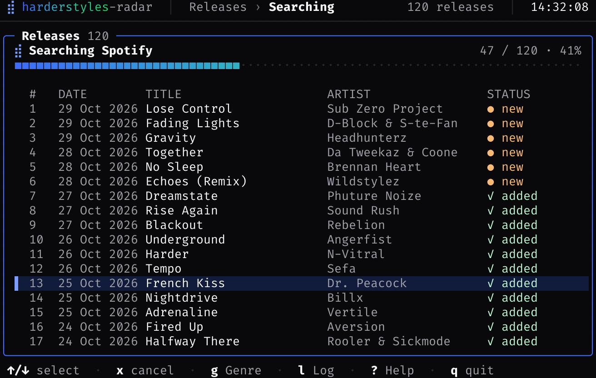

# harderstyles-radar

A single Go binary that keeps a Spotify playlist in sync with the latest hardstyle releases on
[hardstyle.com](https://hardstyle.com). It reads the track lists of the site, finds every release on Spotify and
writes the playlist in the same order as the site: newest first. The playlist holds at most `MAX_TRACKS` tracks
(default 500); beyond that, the oldest entries drop off the end.

The tool runs as an interactive terminal UI (TUI) or as a plain command for cron and service use. It remembers what
it has already looked up, so a daily run only searches the new releases. A service mode checks the site every 15
minutes and touches Spotify only when something new appeared.

## Features

- **Same order as hardstyle.com** — newest release date first, for equal dates the order of the page. Checked on
  every start and corrected when needed.
- **Finds the right track** — ISRC first, then title, artist and date, with tolerance for accents, spelling and
  release dates a few days apart.
- **Albums stay together** — releases that share a catalog number are taken from one Spotify album, including
  older songs on it.
- **Only new releases are searched** — matches, dates and the playlist live in a cache; a repeated run costs one
  request for the snapshot and one or two searches per new release.
- **Service mode** — checks hardstyle.com for new tracks every 15 minutes (`WATCH_INTERVAL`, `-watch`), plus an
  optional full run per day (`-every 24h`). Nothing new means no request to Spotify at all.
- **Several genres or one mixed list** — `GENRES=all` for every genre separately, `GENRES=any` for the general
  list at hardstyle.com/en/tracks, or a comma-separated selection.
- **Easy on the Spotify API** — a pause between requests, a search limit per run, and a stored block when Spotify
  rate-limits the app.
- **Fallback apps** — a second and third Spotify app take over when the first one is blocked.
- **Dry run** — shows what would change without writing anything.
- **English and German** — the UI, the log and the messages follow `UI_LANGUAGE` or `-lang`.
- **Keeps going by itself** — leftover releases, errors and blocks are picked up again after a pause, with a
  countdown in the UI.

## Requirements

- A Spotify account and an app from the [Spotify Developer Dashboard](https://developer.spotify.com/dashboard)
- Go 1.26 or newer to build
- A terminal for the UI; without one the tool writes plain text

## Screenshots

The pictures live in [`docs/screenshots`](docs/screenshots/) and are rendered from the terminal output with
FiraCode as the font, in English at 112 columns × 38 rows. Click a picture to open it full size.

<table>
  <tr>
    <td width="50%" valign="top">
      <a href="docs/screenshots/00-intro.png"></a><br>
      <sub><b>The intro</b><br>The hardstyle.com logo wiped in, an arrow towards Spotify, the Spotify logo opening up. Any key skips it.</sub>
    </td>
    <td width="50%" valign="top">
      <a href="docs/screenshots/01-run.png"></a><br>
      <sub><b>A running sync</b><br>The releases with their status, the selected release on the right, the log and the state of the playlist below.</sub>
    </td>
  </tr>
  <tr>
    <td width="50%" valign="top">
      <a href="docs/screenshots/02-genre.png"></a><br>
      <sub><b>Filtered by genre</b><br><code>g</code> cycles through the genres of the run; the box title names the filter and its count.</sub>
    </td>
    <td width="50%" valign="top">
      <a href="docs/screenshots/03-done.png"></a><br>
      <sub><b>The end of a run</b><br>Added, removed, missing and waiting, and the countdown to the next check for new tracks.</sub>
    </td>
  </tr>
  <tr>
    <td width="50%" valign="top">
      <a href="docs/screenshots/04-dry-run.png"></a><br>
      <sub><b>A dry run</b><br>Nothing is written: the header and the mode say “Dry run”, found tracks are only shown.</sub>
    </td>
    <td width="50%" valign="top">
      <a href="docs/screenshots/05-log.png"></a><br>
      <sub><b>The enlarged log</b><br><code>l</code> lets the log take the whole left column while the playlist stays in view.</sub>
    </td>
  </tr>
  <tr>
    <td width="50%" valign="top">
      <a href="docs/screenshots/06-help.png"></a><br>
      <sub><b>The help</b><br>All keys on one page, with a note on the order of the playlist and the request limits.</sub>
    </td>
    <td width="50%" valign="top">
      <a href="docs/screenshots/07-blocked.png"></a><br>
      <sub><b>When Spotify blocks the app</b><br>The block is reported with the time it ends, stored in the cache, and the next run waits for it.</sub>
    </td>
  </tr>
  <tr>
    <td width="50%" valign="top">
      <a href="docs/screenshots/08-narrow.png"></a><br>
      <sub><b>A narrow terminal</b><br>Below 100 columns the list stands alone; <code>l</code> and <code>?</code> still work.</sub>
    </td>
    <td width="50%" valign="top"></td>
  </tr>
</table>

## Setup

1. Create an app at <https://developer.spotify.com/dashboard> and add `http://127.0.0.1:8888/callback` as a
   redirect URI.
2. The playlist must belong to the Spotify account (since Feb 2026 the API only returns contents for your own
   playlists). The playlist ID is in the URL: `open.spotify.com/playlist/<ID>`.
3. Log in once and fetch the refresh token:

   ```sh
   # put SPOTIFY_CLIENT_ID and SPOTIFY_CLIENT_SECRET into .env first
   go run ./cmd/harderstyles-radar -auth
   ```

4. `cp .env.example .env` and fill in the values. Then start the tool:

   ```sh
   go run ./cmd/harderstyles-radar
   ```

### Configuration (`.env` or environment variables)

The tool reads `.env` from the current directory (another path via `ENV_FILE`); real environment variables take
precedence over the file. `.env` is listed in `.gitignore`.

| Variable | Required | Default | |
|---|---|---|---|
| `SPOTIFY_CLIENT_ID` / `SPOTIFY_CLIENT_SECRET` | yes | | Spotify app |
| `SPOTIFY_REFRESH_TOKEN` | yes | | from `-auth` |
| `SPOTIFY_CLIENT_ID_2` / `_SECRET_2` / `_REFRESH_TOKEN_2` (then `_3` …) | no | | Fallback app that takes over when Spotify blocks the first one. Get the token with `-auth -auth-slot 2` |
| `SPOTIFY_PLAYLIST_ID` | yes | | Target playlist |
| `GENRES` | no | `Hardstyle` | `any` = the general list, whatever the genre; `all` = every genre separately; or comma-separated: `Hardstyle,Hardcore,Uptempo,Frenchcore,Freestyle,Hard Dance,Hard Techno,UK/Happy Hardcore` |
| `PAGES` | no | `2`; with `GENRES=any` enough for `MAX_TRACKS` (17) | Pages per genre, 30 tracks per page |
| `MAX_TRACKS` | no | `500` | Playlist limit |
| `CACHE_FILE` | no | `.hardstyle-sync-cache.json` | Cache: matches, dates, missing tracks, playlist, block |
| `MAX_SEARCHES` | no | `100` | At most this many Spotify searches per run |
| `REQUEST_DELAY` | no | `800ms` | Pause between two Spotify requests |
| `WATCH_INTERVAL` | no | `0` (off) | Service mode: check hardstyle.com for new tracks this often, e.g. `15m` (also `-watch 15m`) |
| `ALBUM_MIN_TRACKS` | no | `2` | From this many tracks sharing the same catalog number, the release counts as an album and all its tracks come from the same Spotify album; `0` turns it off |
| `UI_LANGUAGE` | no | `de` | Language of the UI, the log and the messages: `de` or `en` (also `-lang en`) |
| `CONTINUE_DELAY` | no | `10m` | Pause before the next run when releases are still waiting or a run failed |
| `PLAYLIST_DESCRIPTION` | no | English default text | Playlist description; `{date}`, `{max}` and `{source}` are replaced, `off` leaves the description alone |
| `DATE_TOLERANCE_DAYS` | no | `14` | Allowed difference between the Spotify date and the date on hardstyle.com; a few days are normal (see below) |

## Usage

```sh
go run ./cmd/harderstyles-radar -dry-run      # only shows what would happen
go run ./cmd/harderstyles-radar -status       # Spotify apps: blocks, and whether the refresh tokens still work
go run ./cmd/harderstyles-radar               # UI, starts a run immediately
go run ./cmd/harderstyles-radar -no-tui       # text output only, sync once
go run ./cmd/harderstyles-radar -every 24h    # keep running, once per day
```

| Option | |
|---|---|
| `-auth` | Log in to Spotify once and print the refresh token |
| `-auth-slot <n>` | With `-auth`: log in for fallback app number `n` (`SPOTIFY_CLIENT_ID_<n>`), `1` = the main app |
| `-status` | Show the configured Spotify apps, their blocks and whether their refresh tokens still work |
| `-dry-run` | Show what would change without touching the playlist |
| `-every <d>` | Keep running and do a full sync repeatedly, e.g. `24h` |
| `-watch <d>` | Service: check hardstyle.com for new tracks this often, e.g. `15m` (default: `WATCH_INTERVAL`) |
| `-lang <l>` | Language of the UI and the messages: `de` or `en` |
| `-no-tui` | Plain log output instead of the interface |

Without a terminal (cron, pipe) or with `-no-tui`, only text output is produced.

Without `-every`, a cron entry is enough, e.g. daily at 8:00:

```sh
0 8 * * * cd /path && ./harderstyles-radar
```

## Service mode: check for new tracks every 15 minutes

With `WATCH_INTERVAL=15m` (or `-watch 15m`) the tool runs as a service. The first run is a full one, after that a
**check** follows every 15 minutes: it reads only the first page of the hardstyle.com list and keeps going until
a page contains a known track (so an album spread over several pages is picked up too). If there is nothing new,
**no request at all goes to Spotify**. If there is something new, only those tracks are searched and inserted at
the top of the playlist. Tracks that were not found are re-checked after 12 hours.
With `-every 24h` there is additionally one full run per day.

In the UI, the “Playlist” box shows the countdown (“in 00:14:32 · new tracks”). Without the UI, service
mode only applies with the `-watch` or `-every` option (so that a cron call does not run forever):

```sh
./harderstyles-radar -no-tui -watch 15m -every 24h
```

To keep it running in the background, wrap the command above in a launchd agent (macOS) or a systemd user service
(Linux).

## How the tool finds the tracks on Spotify

For each release the tool works through the following steps and stops at the first hit, to save requests:

1. **ISRC:** The page of each track on hardstyle.com lists the ISRC, the globally unique code of the recording.
   Spotify is searched for it exactly, regardless of spelling (one request). Not every track has the same code on
   Spotify; in that case the tool moves on.
2. **Title and artist:** Accents and special letters do not matter (`Juliex` is `Juliëx`, `GRIVO` is `GRIVØ`,
   `Jose` is `José`), neither do spaces or letter case. The artist must be the same or start with the same name.
   The second line under the title on hardstyle.com (the version, e.g. “Fiesta Mix”) is part of the title; on
   Spotify the track is called “Title - Fiesta Mix”.
3. **Date:** hardstyle.com and Spotify often give dates a few days apart for the same release (pre-sale, shop,
   postponed date). That is why the Spotify date may be off by up to `DATE_TOLERANCE_DAYS` (14) days. If it is
   further off, it is usually an old version of the same title – unless title and artist match and the difference
   stays below 45 days: then the track is included anyway and the UI shows “Date differs by N days”. Anything
   beyond that counts as a different release and is left out.
4. **Remixes:** If a track has further versions on Spotify in the title (“Title - Some Remix”, “Title (Happy
   Mix)”) with the same artist and date, they are added to the playlist too (at most 4 per release).
5. **Albums:** Each track is searched individually. For an album, one track might be found as a single and the next
   one on the album. That is why the tool reads the **catalog number** (e.g. `MINUS288`) from each track's page.
   All tracks of an album share it, even when different artists appear on it. From `ALBUM_MIN_TRACKS` (2) tracks
   with the same number, the tool determines the common Spotify album:
   - Each track votes for the albums on which the search found it. The album with the most votes wins. It needs at
     least 2 votes and half of the tracks, and its date must match the date on hardstyle.com. An old album by the
     artist with the same songs therefore does not count.
   - The track list of that album is read once and remembered. Every track of the album on hardstyle.com comes from
     there, including older songs whose single has an old date. The single is dropped, remixes stay.
     The UI then shows “from the album …”.
   - Tracks that are waiting because of the search limit, or that the search does not find, come straight from the
     track list, without a search of their own.
   - If a track is not on the album, it keeps its own match. If there is no album on Spotify (yet), the individual
     matches stay.

When this procedure improves, the tool re-checks all previously unfound tracks once on its own.

## How the playlist stays like hardstyle.com

- **Order:** The playlist has the same order as the list on hardstyle.com: newest release date first, and for equal
  dates the order of the page. This is checked on every start and corrected if necessary. The normal case (new tracks
  on top, old ones dropped at the end) needs only two write requests; a wrong order is rewritten with 1 to 5
  requests. Tracks that are no longer among the newest releases stay behind them in their order; beyond
  `MAX_TRACKS` the end is cut off.
- **Date:** For each release the tool reads the release date from its page on hardstyle.com and compares it with
  the Spotify match. A few days of difference are normal and allowed (`DATE_TOLERANCE_DAYS`, default 14); if title
  and artist match and the difference stays below 45 days, the track is included as well and marked “Date differs
  by N days”. This way neither an old version of the same title ends up in the playlist, nor is a track missing
  because the two sites name the day differently. The date is shown in the UI in the list and in the details;
  `✗ date` means: a track with that name exists, but with a clearly different date. Note: albums that contain
  singles released earlier are also sorted out by this (that is what the album check via the catalog number is for).
- **Missing tracks:** Whatever is missing on Spotify (not found or wrong date) is remembered with the reason and
  the number of attempts, and searched again on the next run after 12 hours at the latest.
- **What already exists:** The playlist is stored in the cache together with its snapshot. On startup the tool only
  queries the snapshot (1 request); only if the playlist has changed in the meantime or the cache is older than
  7 days does it read the playlist in full. Releases that have already been found are never searched again.

## Playlist description

After every successful run (not in a dry run) the tool sets the playlist description, in English, with the source
and the date of the last update, for example:

> Daily updated. The latest all-genre releases from hardstyle.com, in the same order as on the site (newest first), max. 500 tracks. Last update: 29 Oct 2026

The text contains the date, so it changes at most once a day, and only then does the tool write it (one request).
Use `PLAYLIST_DESCRIPTION` for your own text; Spotify accepts at most 300 characters. If setting it fails, this is
logged, and the run still counts as successful.

## The tool keeps going on its own

A run searches at most `MAX_SEARCHES` releases. If anything is left over, the next run starts by itself after
`CONTINUE_DELAY` (10 minutes) until everything is done. In the UI this always applies; without the UI it applies
with `-every`. The same happens after an error (with growing pauses, at most one hour) and after a Spotify block,
as soon as it is over. The “Playlist” box shows the countdown with the reason. A dry run does not continue on its
own, and `x` cancels without restarting.

An error no longer ends the whole run:

- If a search fails, only that release waits for the next run; the others are processed normally. Short network or
  server errors (5xx) are retried twice for read requests; write calls are never retried, so nothing ends up in the
  playlist twice.
- After 5 failed searches in a row or a Spotify block, only the search stops; whatever was found up to then still
  goes into the playlist.

## Going easy on the Spotify API

Spotify blocks apps that send too many requests, quickly for **up to 24 hours** in development mode. Hence:

| Measure | Setting |
|---|---|
| Pause between two requests, twice as long after a `429` | `REQUEST_DELAY` (800ms) |
| Search at most this many releases per run, new ones first, the rest next time | `MAX_SEARCHES` (100) |
| Search only new releases; matches, dates and the playlist are kept in `CACHE_FILE` | `.hardstyle-sync-cache.json` |
| A second search request only if the first returns nothing suitable | |
| A long block (`Retry-After` over 60 s) is reported immediately and **stored**: no start sends requests until it is over | |

In everyday use a run therefore costs one request for the snapshot, one to two searches per new release and one to
two write requests. The first run with many genres fills the playlist over several runs (`MAX_SEARCHES` each).
Under “Requests” in the UI you can see the number of requests of the run.

## General list instead of genres

With `GENRES=any` the tool does not query a genre but the general list at `hardstyle.com/en/tracks`, in which all
genres are mixed. The playlist then gets at most `MAX_TRACKS` (500) tracks in exactly the order of that list.
`PAGES` is automatically large enough to collect 500 tracks (17 pages). If a track is missing on Spotify, the
playlist is correspondingly shorter; a larger `PAGES` lets more tracks move up.
For a single list (`any` or one genre) the order of page 1 is applied 1:1; with several genres the lists are
merged by release date.

## Language

The UI, the log and the messages are available in German and English. Set `UI_LANGUAGE=en` in `.env` or run
`go run ./cmd/harderstyles-radar -lang en`; the option takes precedence over the setting, and without either
the default is German. The value is `de` or `en`; spellings like `de_DE.UTF-8` or `english` are understood too. The
playlist description is always English (`PLAYLIST_DESCRIPTION`), and the cache is language-independent, so
switching the language does not affect remembered tracks. The language applies from startup; restart the tool to
switch.

## UI

In a terminal the tool starts an interface and begins a run immediately: progress at the top (reading releases,
searching Spotify, updating the playlist), below it all releases with their status (`● new`, `✓ in list`,
`✓ added`, `✗ missing`), details of the selected release on the right, and at the bottom the log and the state of
the playlist (tracks out of 500, oldest and newest, next run).

| Key | |
|---|---|
| `↑`/`↓`, `j`/`k`, `PgUp`/`PgDn`, `Home`/`End` | Select a release |
| `s` | Sync now |
| `x` / `Esc` | Cancel the current run |
| `d` | Toggle dry run (writes nothing) |
| `g` | Filter by genre |
| `l` | Show the log enlarged |
| `?` | Help |
| `q` / `Ctrl+C` | Quit |

With `-every 24h` the UI keeps running and starts a new run every day; the “Playlist” box shows the countdown.
Below 100 columns the list fills the whole height; the log stays available with `l` and the help with `?`.

## Build

```sh
go build -o harderstyles-radar ./cmd/harderstyles-radar
```

Prebuilt archives for Linux, macOS and Windows (amd64 and arm64) are on the
[releases](https://github.com/revunix/harderstyles-radar/releases) page, each with a `checksums.txt` to verify:

```sh
sha256sum -c checksums.txt
```

The binary has no dependencies of its own; the cache is a single JSON file next to it (or wherever `CACHE_FILE`
points).

## Docker

```sh
docker build -t harderstyles-radar .
```

One sync now, with `.env` and the cache in the current directory:

```sh
docker run --rm -v "$PWD:/data" harderstyles-radar -no-tui
```

Service mode: check every 15 minutes, a full sync once a day, and restart with the machine:

```sh
docker run -d --name harderstyles-radar --restart unless-stopped \
  -v "$PWD:/data" \
  harderstyles-radar -no-tui -watch 15m -every 24h
```

The interface, which needs a terminal:

```sh
docker run --rm -it -v "$PWD:/data" harderstyles-radar
```

`/data` is the working directory inside the image: the `.env` is read from there and the cache is written to
`/data/hardstyle-sync-cache.json`. Instead of a `.env`, pass the variables with `-e`:

```sh
docker run --rm \
  -e SPOTIFY_CLIENT_ID=... \
  -e SPOTIFY_CLIENT_SECRET=... \
  -e SPOTIFY_REFRESH_TOKEN=... \
  -e SPOTIFY_PLAYLIST_ID=... \
  -v harderstyles-data:/data \
  harderstyles-radar -no-tui
```

With `--user "$(id -u):$(id -g)"` the cache file belongs to your user instead of root.

## Layout

```
cmd/harderstyles-radar/   Entry point: flags, .env, language and wiring
internal/config/          Settings from environment and .env
internal/i18n/            German/English, date and duration texts
internal/hardstyle/       Reading hardstyle.com (list, detail page, ISRC)
internal/match/           Comparing title, artist and date
internal/spotify/         Spotify API, login, searching for a release
internal/cache/           Cache (matches, dates, playlist, block)
internal/event/           Events of a run for the UI
internal/sync/            One run: read, search, write playlist, schedule
internal/tui/             UI (bubbletea/lipgloss)
```

Packages depend on each other in one direction only: `tui` and `sync` on top, below them `spotify`, `cache`,
`hardstyle`, `match`, `config`; `i18n` and `event` are available everywhere.

## Tests

```sh
go test ./...
HS_LIVE=1 go test -run Live -v ./...   # checks the parser against the real site
```

The screenshots are rendered from the terminal output too, see [`docs/screenshots`](docs/screenshots/).

## License

[MIT](LICENSE)
