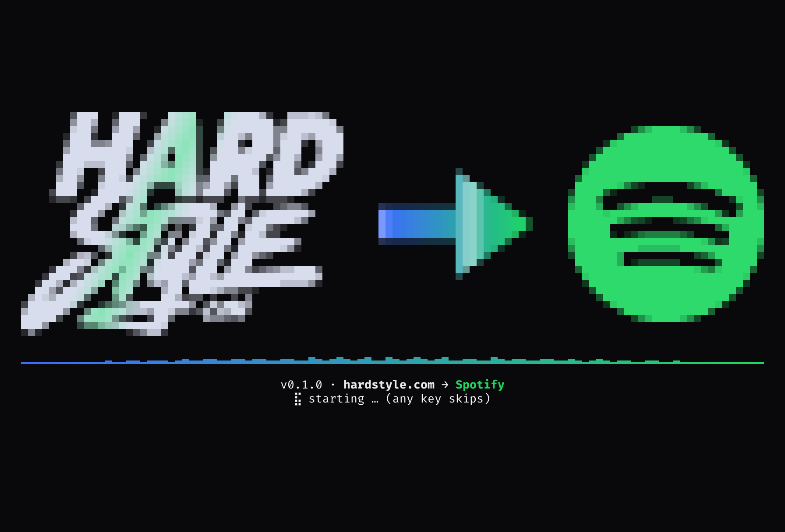
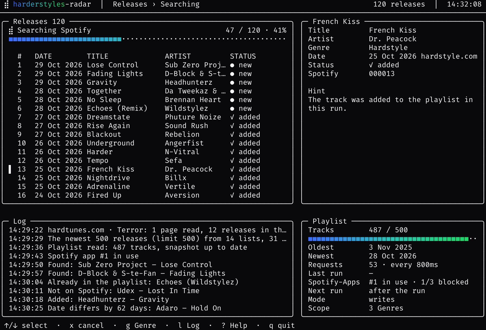
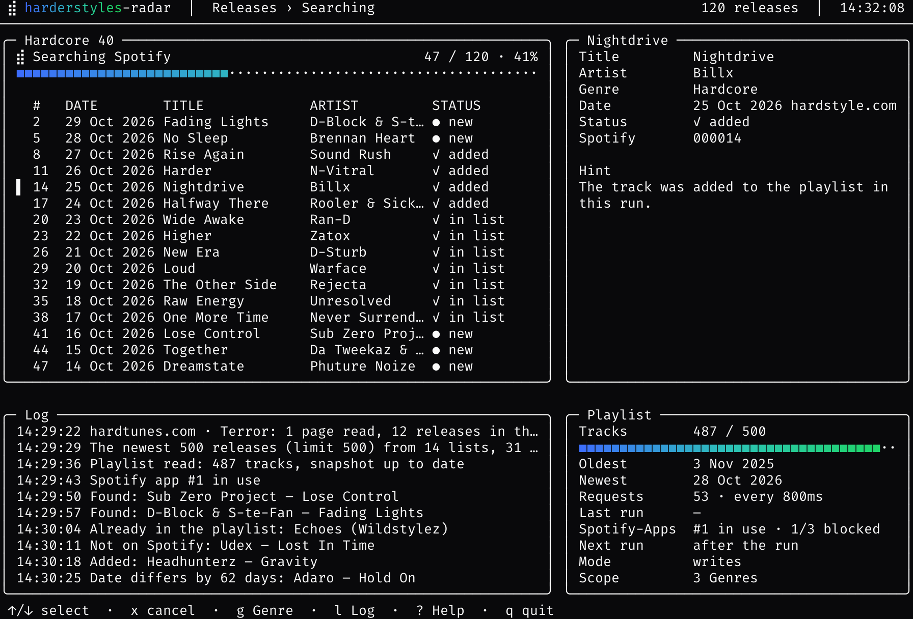
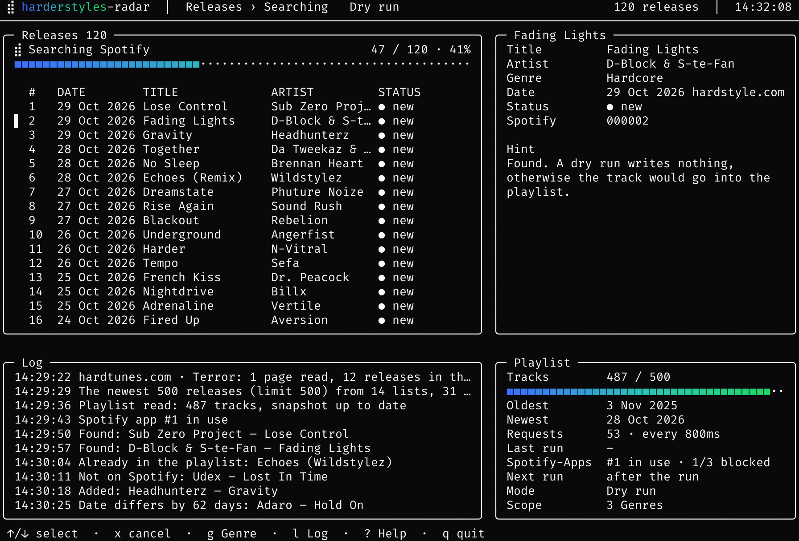
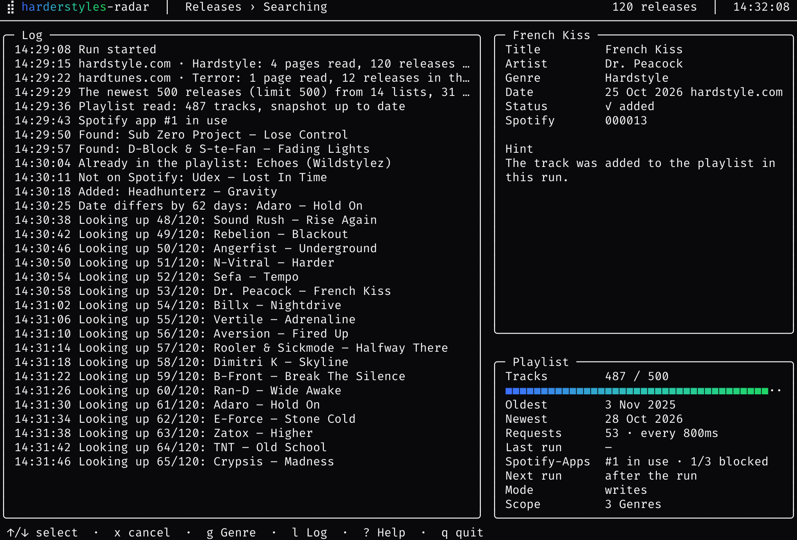
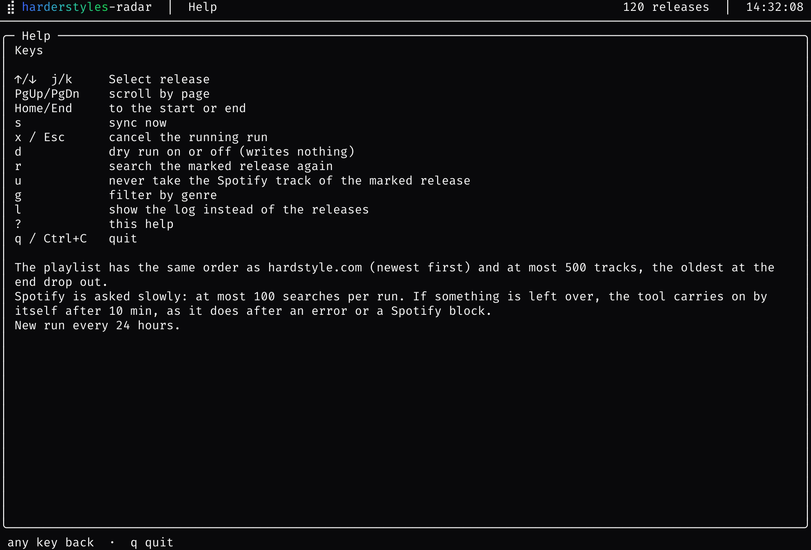
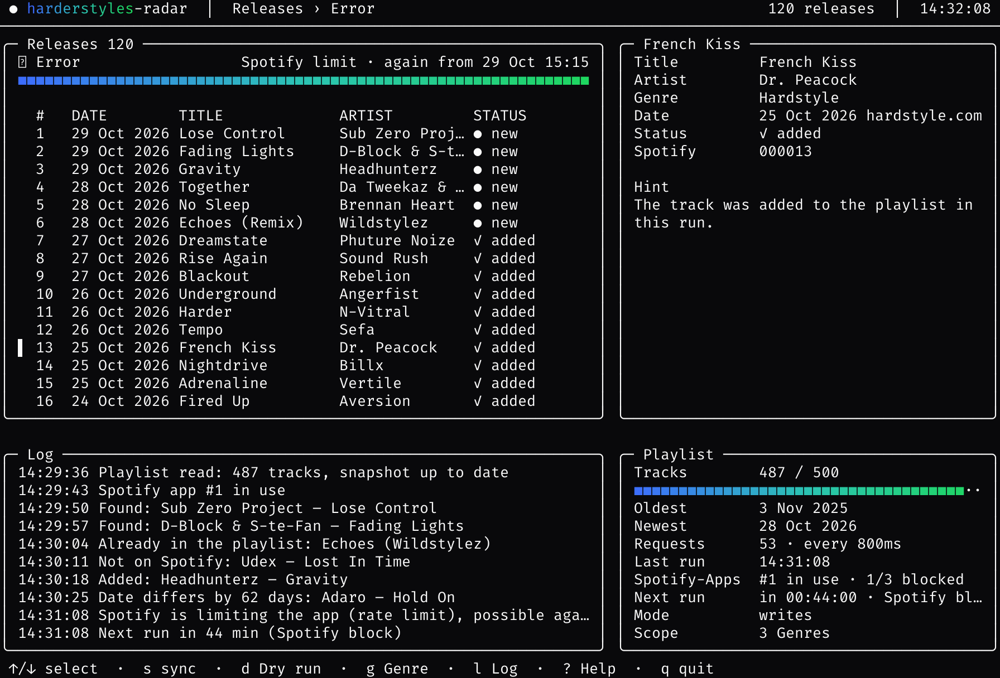
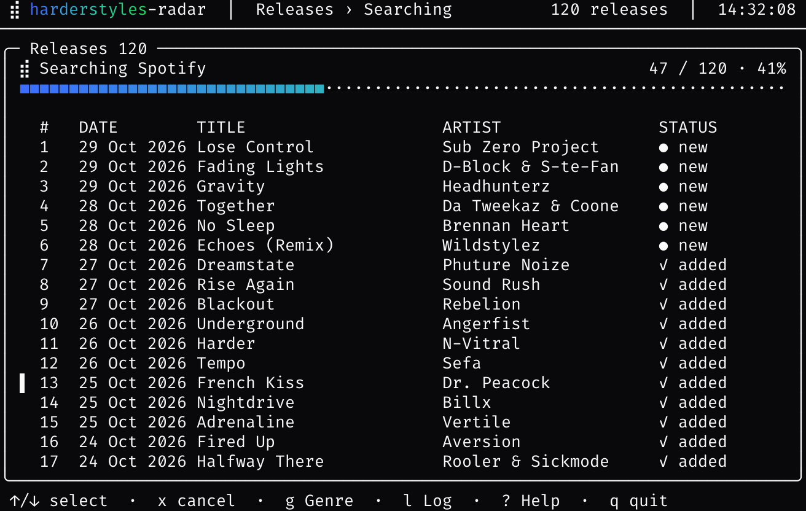

# harderstyles-radar

A single Go binary that keeps a Spotify playlist in sync with the latest hardstyle releases on
[hardstyle.com](https://hardstyle.com) and [hardtunes.com](https://www.hardtunes.com). It reads the newest
releases of the track lists of both sites, enough to fill `MAX_TRACKS` tracks (default 500), finds them on Spotify
and writes the playlist, newest first or sorted as `PLAYLIST_ORDER` says. A new release pushes the oldest out.

The tool runs as an interactive terminal UI (TUI) or as a plain command for cron and service use. It remembers what
it has already looked up, so a daily run only searches the new releases. A service mode checks the site every 15
minutes and touches Spotify only when something new appeared.

## Features

- **Only the newest `MAX_TRACKS`** — the lists of all genres of both sites are merged by release date and read
  page by page only as far as the newest `MAX_TRACKS` releases reach, plus one more release for every one that
  Spotify does not have, so the playlist fills up; only those are looked up on Spotify. A new release pushes the
  oldest out, of the search as of the playlist.
- **Your order** — newest first (default), oldest first, by artist or by title (`PLAYLIST_ORDER`). Checked on
  every start and corrected when needed.
- **Finds the right track** — ISRC first, then a score of title, artists, track length, version and date. The
  length tells an Extended Mix from a Radio Edit; when two recordings fit almost equally, none is guessed and
  the release is marked “uncertain”. Artist aliases are learned from ISRC matches. `-evaluate` measures the
  matching offline.
- **Albums stay together** — releases that share a catalog number are taken from one Spotify album, including
  older songs on it.
- **Only new releases are searched** — matches, dates and the playlist live in a cache; a repeated run costs one
  request for the snapshot and one or two searches per new release.
- **Service mode** — checks hardstyle.com for new tracks every 15 minutes (`WATCH_INTERVAL`, `-watch`), plus an
  optional full run per day (`-every 24h`). Nothing new means no request to Spotify at all.
- **Several genres or one mixed list** — `GENRES=all` for every genre separately, `GENRES=any` for the general
  list at hardstyle.com/en/tracks, or a comma-separated selection.
- **Second source: hardtunes.com** — every run also reads the genre lists of hardtunes.com (`HARDTUNES_GENRES`),
  which has releases hardstyle.com lacks. A release on both sites is taken once, from hardstyle.com; an album on
  hardtunes.com is replaced by its tunes. `-compare` shows what is on both sites and what only on one, no Spotify
  needed.
- **Every genre can keep its place** — `GENRE_MIN` keeps the newest releases of every genre in the window, however
  busy the others are.
- **Notices when a site changes** — unreadable or empty lists, missing dates or lengths are reported as warnings,
  in the log and on Discord; an unreadable list is skipped, not the whole run.
- **Easy on the Spotify API** — a pause between requests, a search limit per run, and a stored block when Spotify
  rate-limits the app. A release that is not out yet is not searched before its day.
- **Fallback apps** — a second and third Spotify app take over when the first one is blocked.
- **Dry run** — shows what would change without writing anything.
- **Discord summary** — every full run, and every check that found new tracks, reports to a Discord webhook: what
  changed, which tracks came in, and what is missing. A failed run reports its error.
- **English and German** — the UI, the log and the messages follow `UI_LANGUAGE` or `-lang`.
- **Keeps going by itself** — leftover releases, errors and blocks are picked up again after a pause, with a
  countdown in the UI.

## Requirements

- A Spotify account and an app from the [Spotify Developer Dashboard](https://developer.spotify.com/dashboard)
- Go 1.26 or newer to build
- A terminal for the UI; without one the tool writes plain text

## Screenshots

The pictures live in [`docs/screenshots`](docs/screenshots/) and are rendered from the terminal output with
FiraCode as the font, in English at 112 columns × 38 rows. Click a picture to open it full size.

<table>
  <tr>
    <td width="50%" valign="top">
      <a href="docs/screenshots/00-intro.png"></a><br>
      <sub><b>The intro</b><br>The hardstyle.com logo wiped in, an arrow towards Spotify, the Spotify logo opening up. Any key skips it.</sub>
    </td>
    <td width="50%" valign="top">
      <a href="docs/screenshots/01-run.png"></a><br>
      <sub><b>A running sync</b><br>The releases with their status, the selected release on the right, the log and the state of the playlist below.</sub>
    </td>
  </tr>
  <tr>
    <td width="50%" valign="top">
      <a href="docs/screenshots/02-genre.png"></a><br>
      <sub><b>Filtered by genre</b><br><code>g</code> cycles through the genres of the run; the box title names the filter and its count.</sub>
    </td>
    <td width="50%" valign="top">
      <a href="docs/screenshots/03-done.png"></a><br>
      <sub><b>The end of a run</b><br>Added, removed, missing and waiting, and the countdown to the next check for new tracks.</sub>
    </td>
  </tr>
  <tr>
    <td width="50%" valign="top">
      <a href="docs/screenshots/04-dry-run.png"></a><br>
      <sub><b>A dry run</b><br>Nothing is written: the header and the mode say “Dry run”, found tracks are only shown.</sub>
    </td>
    <td width="50%" valign="top">
      <a href="docs/screenshots/05-log.png"></a><br>
      <sub><b>The enlarged log</b><br><code>l</code> lets the log take the whole left column while the playlist stays in view.</sub>
    </td>
  </tr>
  <tr>
    <td width="50%" valign="top">
      <a href="docs/screenshots/06-help.png"></a><br>
      <sub><b>The help</b><br>All keys on one page, with a note on the order of the playlist and the request limits.</sub>
    </td>
    <td width="50%" valign="top">
      <a href="docs/screenshots/07-blocked.png"></a><br>
      <sub><b>When Spotify blocks the app</b><br>The block is reported with the time it ends, stored in the cache, and the next run waits for it.</sub>
    </td>
  </tr>
  <tr>
    <td width="50%" valign="top">
      <a href="docs/screenshots/08-narrow.png"></a><br>
      <sub><b>A narrow terminal</b><br>Below 100 columns the list stands alone; <code>l</code> and <code>?</code> still work.</sub>
    </td>
    <td width="50%" valign="top"></td>
  </tr>
</table>

## Setup

1. Create an app at <https://developer.spotify.com/dashboard> and add `http://127.0.0.1:8888/callback` as a
   redirect URI.
2. The playlist must belong to the Spotify account (since Feb 2026 the API only returns contents for your own
   playlists). The playlist ID is in the URL: `open.spotify.com/playlist/<ID>`.
3. Log in once and fetch the refresh token:

   ```sh
   # put SPOTIFY_CLIENT_ID and SPOTIFY_CLIENT_SECRET into .env first
   go run ./cmd/harderstyles-radar -auth
   ```

4. `cp .env.example .env` and fill in the values. Then start the tool:

   ```sh
   go run ./cmd/harderstyles-radar
   ```

### Configuration (`.env` or environment variables)

The tool reads `.env` from the current directory (another path via `ENV_FILE`); real environment variables take
precedence over the file. `.env` is listed in `.gitignore`.

| Variable | Required | Default | |
|---|---|---|---|
| `SPOTIFY_CLIENT_ID` / `SPOTIFY_CLIENT_SECRET` | yes | | Spotify app |
| `SPOTIFY_REFRESH_TOKEN` | yes | | from `-auth` |
| `SPOTIFY_CLIENT_ID_2` / `_SECRET_2` / `_REFRESH_TOKEN_2` (then `_3` …) | no | | Fallback app that takes over when Spotify blocks the first one. Get the token with `-auth -auth-slot 2` |
| `SPOTIFY_PLAYLIST_ID` | yes | | Target playlist |
| `GENRES` | no | `Hardstyle` | `any` = the general list, whatever the genre; `all` = every genre separately; or comma-separated: `Hardstyle,Hardcore,Uptempo,Frenchcore,Freestyle,Hard Dance,Hard Techno,UK/Happy Hardcore` |
| `PAGES` | no | enough for `MAX_TRACKS` from one list (`MAX_TRACKS`/20); `2` for `-compare` | The most pages a run may read of one list. A run reads only as far as the releases it needs reach, so this is a safety cap; `-compare` reads this many pages of every list |
| `HARDTUNES_GENRES` | no | all six: `hardstyle,hardcore,terror,frenchcore,early-rave,hard-techno` | Genre lists of hardtunes.com read by every run and by `-compare`: `https://www.hardtunes.com/<genre>/page/1/`; `none` switches the second source off |
| `MAX_TRACKS` | no | `500` | The playlist holds at most this many tracks. The newest this many releases are read and looked up, and one more for every release Spotify does not have, so the playlist fills up |
| `PLAYLIST_ORDER` | no | `newest` | `newest` (release date, newest first), `oldest` (newest at the end), `artist` or `title`. The newest `MAX_TRACKS` are kept whatever the order |
| `GENRE_MIN` | no | `0` | Every genre keeps at least its newest this many releases, however busy the other genres are (e.g. `10` keeps Terror and Uptempo in a playlist full of Hardstyle); `0` = only the release date counts |
| `EVAL_SAMPLES` | no | `5` | Per run, this many releases the ISRC found are also searched by title, so `-evaluate` can measure the title matching against the ISRC's answer. Each costs one or two extra Spotify searches; `0` = off |
| `CACHE_FILE` | no | `.hardstyle-sync-cache.json` | Cache: matches, dates, missing tracks, playlist, block |
| `CORRECTIONS_FILE` | no | `corrections.txt` next to the cache | Releases whose Spotify track was refused (see below) |
| `MAX_SEARCHES` | no | `100` | At most this many Spotify searches per run |
| `REQUEST_DELAY` | no | `800ms` | Pause between two Spotify requests |
| `WATCH_INTERVAL` | no | `0` (off) | Service mode: check hardstyle.com for new tracks this often, e.g. `15m` (also `-watch 15m`) |
| `SYNC_EVERY_MINUTES` | no | off | Run a full sync every this many minutes (also `-every-minutes`) |
| `SYNC_AT` | no | off | Run a full sync daily at `HH:MM` (requires `SYNC_TIMEZONE`) |
| `SYNC_TIMEZONE` | with `SYNC_AT` | | IANA time zone, e.g. `Europe/Berlin` |
| `ALBUM_MIN_TRACKS` | no | `2` | From this many tracks sharing the same catalog number, the release counts as an album and all its tracks come from the same Spotify album; `0` turns it off |
| `UI_LANGUAGE` | no | `de` | Language of the UI, the log and the messages: `de` or `en` (also `-lang en`) |
| `NO_COLOR` | no | | Set to anything (or `TERM=dumb`) and the interface draws as plain text, without color. The layout stays the same |
| `CONTINUE_DELAY` | no | `10m` | Pause before the next run when releases are still waiting or a run failed |
| `PLAYLIST_DESCRIPTION` | no | English default text | Playlist description; `{date}`, `{max}`, `{source}` (the genres) and `{sites}` (hardstyle.com, plus hardtunes.com when it is on) are replaced, `off` leaves the description alone |
| `DISCORD_WEBHOOK_URL` | no | | Send the summary of a run to this Discord webhook (channel → Edit Channel → Integrations → Webhooks). Empty: nothing is sent |
| `DATE_TOLERANCE_DAYS` | no | `14` | Allowed difference between the Spotify date and the date on hardstyle.com; a few days are normal (see below) |

## Usage

```sh
go run ./cmd/harderstyles-radar -dry-run      # only shows what would happen
go run ./cmd/harderstyles-radar -status       # Spotify apps: blocks, and whether the refresh tokens still work
go run ./cmd/harderstyles-radar               # UI, starts a run immediately
go run ./cmd/harderstyles-radar -no-tui       # text output only, sync once
go run ./cmd/harderstyles-radar -every 24h    # keep running, once per day
go run ./cmd/harderstyles-radar -compare      # compare hardstyle.com and hardtunes.com, no Spotify needed
```

| Option | |
|---|---|
| `-auth` | Log in to Spotify once and print the refresh token |
| `-auth-slot <n>` | With `-auth`: log in for fallback app number `n` (`SPOTIFY_CLIENT_ID_<n>`), `1` = the main app |
| `-status` | Show the configured Spotify apps, their blocks and whether their refresh tokens still work |
| `-dry-run` | Show what would change without touching the playlist |
| `-every <d>` | Keep running and do a full sync repeatedly, e.g. `24h` |
| `-every-minutes <n>` | Keep running and do a full sync every `n` minutes |
| `-at <HH:MM> -timezone <zone>` | Keep running and do a full sync every day at that local time, e.g. `-at 08:00 -timezone Europe/Berlin` |
| `-watch <d>` | Service: check hardstyle.com for new tracks this often, e.g. `15m` (default: `WATCH_INTERVAL`) |
| `-lang <l>` | Language of the UI and the messages: `de` or `en` |
| `-no-tui` | Plain log output instead of the interface |
| `-compare` | Compare the releases of hardstyle.com and hardtunes.com with each other and exit (uses `GENRES`, `HARDTUNES_GENRES`, `PAGES`) |
| `-evaluate` | Measure the Spotify matching offline on what the cache learned and exit (no Spotify needed, see below) |

Without a terminal (cron, pipe) or with `-no-tui`, only text output is produced.

For a daily run at a fixed time, give the time zone explicitly:

```sh
./harderstyles-radar -at 08:00 -timezone Europe/Berlin
```

For an interval in minutes:

```sh
./harderstyles-radar -every-minutes 30
```

Without a service schedule, a cron entry is enough, e.g. daily at 8:00:

```sh
0 8 * * * cd /path && ./harderstyles-radar
```

## Correcting a wrong match

A match is remembered for good, so a wrong one would come back on every run. `corrections.txt`, next to the cache,
names the releases to correct. One release per line, `#` starts a comment:

```
# <id>  retry                 look it up again
# <id>  skip   <spotify-uri>  never take this Spotify track
# <id>  force  <spotify-uri>  take exactly this Spotify track
1234567  retry
1234890  skip   spotify:track:abc
1234999  force  spotify:track:def
```

The id is the track id on hardstyle.com (the product number on hardtunes.com). `retry` drops the remembered track
once and searches again. `skip` remembers the Spotify track and never picks it again, then searches for another
one. `force` takes the given track and never searches the release again — this is how an **uncertain** release (two
Spotify tracks fit almost equally well, see below) is decided. The file is read on every run, so it works the same
for cron and `-no-tui`. A missing file does nothing.

In the interface, `r` on the marked release writes a `retry` line and `u` writes a `skip` line for its Spotify
track. Both start a run straight away. They do nothing while a run is going.

## Service mode: check for new tracks every 15 minutes

With `WATCH_INTERVAL=15m` (or `-watch 15m`) the tool runs as a service. The first run is a full one, after that a
**check** follows every 15 minutes: it reads each list page by page only until a page contains a known release (so
an album spread over several pages is picked up too). If there is nothing new, **no request at all goes to
Spotify**. If there is something new, the check reads the lists as far as a full run does, so the playlist is
built from all the newest releases, not just from the first pages; only the new tracks are searched and inserted,
the oldest drop out at the end, as with any run. Tracks that were not found are re-checked after 12 hours.
With `-every 24h` there is additionally one full run per day.

In the UI, the “Playlist” box shows the countdown (“in 00:14:32 · new tracks”). Without the UI, service
mode only applies with the `-watch` or `-every` option (so that a cron call does not run forever):

```sh
./harderstyles-radar -no-tui -watch 15m -every 24h
```

To keep it running in the background, wrap the command above in a launchd agent (macOS) or a systemd user service
(Linux).

## How the tool finds the tracks on Spotify

For each release the tool works through the following steps and stops at the first answer, to save requests:

1. **ISRC:** The release pages of both sites name the ISRC, the globally unique code of the recording. Spotify is
   searched for it exactly (one request). The recording is certain, but its **release date is checked as well**: the
   same recording comes out again years later on a re-master or a compilation, and such an old track must not enter
   a playlist of the newest releases. A track whose Spotify date is within `DATE_TOLERANCE_DAYS` is taken; up to 45
   days off it is taken and marked; more than that and the release goes to the title search instead (and is reported
   as “date differs” when that finds nothing either). Not every track has the same code on Spotify; then the tool
   moves on as well.
2. **Title search, scored:** Spotify is searched for title and artist (a second, fielded search only if the first
   decides nothing). Every track found gets a score:

   | Evidence | Points |
   |---|---|
   | Title with the version of the site / without it / only another version (remix) | +3 / +2 / +0.5 |
   | Artists: share of the same artists on both sides (order, “&”, “and”, accents do not matter; learned aliases count) | up to +1 |
   | Length within 5 s / 30 s or more apart (both sites name the length to the second) | +1.5 / −2.5 |
   | Different remix names / different cuts named (Extended against Radio) | −1 / −1 |
   | Date within `DATE_TOLERANCE_DAYS` / up to 45 days off / more | 0 / up to −1 / rejected |

   A clean match scores about 4; the best track is taken from 1 point on. The length is what tells an Extended
   Mix (5:30) from a Radio Edit (3:10) when Spotify's titles do not. When a release page names no date at all, no
   track older than the oldest release of the window (less the same 45 days) is taken.
3. **Uncertain:** When a *different* recording scores almost the same (less than 0.75 points behind) and nothing
   else prefers the best — a better title, or a length that fits where the other's does not — the tool takes
   neither: a wrong track in the playlist is worse than a missing one. The release shows as “uncertain” in the UI and
   in the Discord summary; a `force` line in `corrections.txt` decides it, otherwise it is searched again later.
4. **Remixes:** Other versions of the song on Spotify (“Title - Some Remix”) with the same artist come along into
   the playlist (at most 4 tracks per release). They never compete with the release itself.
5. **Artist aliases:** When the ISRC confirms a match, the tool remembers which Spotify artist each site artist
   is. An artist the two sides spell differently (“Smurf” and “DJ Smurf”) is then recognised by the Spotify id.
6. **Albums:** Each track is searched individually. For an album, one track might be found as a single and the next
   one on the album. That is why the tool reads the **catalog number** (e.g. `MINUS288`) from each track's page.
   All tracks of an album share it, even when different artists appear on it. From `ALBUM_MIN_TRACKS` (2) tracks
   with the same number, the tool determines the common Spotify album:
   - Each track votes for the albums on which the search found it. The album with the most votes wins. It needs at
     least 2 votes and half of the tracks, and its date must match the date on hardstyle.com. An old album by the
     artist with the same songs therefore does not count.
   - The track list of that album is read once and remembered. Every track of the album on hardstyle.com comes from
     there, including older songs whose single has an old date. The single is dropped, remixes stay.
     The UI then shows “from the album …”.
   - Tracks that are waiting because of the search limit, or that the search does not find, come straight from the
     track list, without a search of their own.
   - If a track is not on the album, it keeps its own match. If there is no album on Spotify (yet), the individual
     matches stay.

When this procedure improves, the tool re-checks all previously unfound tracks once on its own.

### Measuring the matching: `-evaluate`

`go run ./cmd/harderstyles-radar -evaluate` measures the title matching offline, without a single request. The
cache keeps what the title searches found for each release. Matches the ISRC confirmed (`EVAL_SAMPLES` per run
are also searched by title for this) and `force` corrections are the truth; the matching is replayed on the kept
searches and counted: correct, wrong, uncertain, missed, and unreachable (the search did not find the true track
at all). It prints precision and recall, plus the same for a grid of other thresholds, so a change of the weights
can be judged by numbers instead of by feel. The numbers grow with every run.

## How the playlist stays up to date

- **Which releases:** The newest `MAX_TRACKS` releases of all lists of both sites (with `GENRE_MIN`, every genre's
  newest come first), and one older release more for every one that Spotify does not have, so the tracks can fill
  `MAX_TRACKS`. The lists are sorted newest first, so the tool merges them by release date and reads only as
  many pages as that needs. hardstyle.com names the date on the release page (read once, then kept in the cache).
  hardtunes.com names fresh releases by day and older ones only by week in its list; the tune page names the day,
  and once known it is kept. A release on both sites (same artists, title and version in any spelling, or the
  same ISRC) is taken once, from hardstyle.com.
- **Order:** `PLAYLIST_ORDER`: newest release date first (default; equal dates in the order of the lists), oldest
  first, by artist or by title. The versions of one release stay together. This is checked on every start and
  corrected if necessary. With `newest`, the normal case (new tracks on top, old ones dropped at the end) needs
  only two write requests; other orders and a wrong order are rewritten with 1 to 5 requests. Tracks that are no
  longer among the newest releases stay as long as there is room, ranked by their release date; beyond
  `MAX_TRACKS` the oldest drop out.
- **Date:** For each release the tool reads the release date from its page (hardstyle.com: the release page,
  hardtunes.com: the tune page) and compares it with the Spotify match — on every path, also when the ISRC found
  the recording. A few days of difference are normal and allowed (`DATE_TOLERANCE_DAYS`, default 14); if title
  and artist match and the difference stays below 45 days, the track is included as well and marked “Date differs
  by N days”. Beyond that it is not taken, whatever named it: this way neither an old version of the same title
  nor an old re-master with the same ISRC ends up in the playlist. The date is shown in the UI in the list and in
  the details; `✗ date` means: a track with that name exists, but with a clearly different date. Matches already
  in the cache whose Spotify date is that far off are dropped once, so they are searched again. Note: albums that
  contain singles released earlier are also sorted out by this (that is what the album check via the catalog
  number is for).
- **Missing tracks:** Whatever is missing on Spotify (not found or wrong date) is remembered with the reason and
  the number of attempts, and searched again on the next run after 12 hours at the latest.
- **What already exists:** The playlist is stored in the cache together with its snapshot. On startup the tool only
  queries the snapshot (1 request); only if the playlist has changed in the meantime or the cache is older than
  7 days does it read the playlist in full. Releases that have already been found are never searched again.

## Playlist description

After every successful run (not in a dry run) the tool sets the playlist description, in English, with the source
and the date of the last update, for example:

> Daily updated. The latest all-genre releases from hardstyle.com and hardtunes.com, newest first, max. 500 tracks. Last update: 29 Oct 2026

The text contains the date, so it changes at most once a day, and only then does the tool write it (one request).
Use `PLAYLIST_DESCRIPTION` for your own text; Spotify accepts at most 300 characters. If setting it fails, this is
logged, and the run still counts as successful.

## Discord summary

With `DISCORD_WEBHOOK_URL` set, the tool posts a short summary to that Discord channel: what the run changed, which
tracks came into the playlist, and the counts of the run. A webhook is made in the channel settings under
**Integrations → Webhooks → New Webhook → Copy Webhook URL**; paste that address into `.env`:

```sh
DISCORD_WEBHOOK_URL=https://discord.com/api/webhooks/123456789/abcdef...
```

When a message is sent:

- **Full run** — always, also when nothing changed (“Nichts Neues”, with the size of the playlist). This makes the
  optional daily run a small heartbeat.
- **Check for new tracks** (`WATCH_INTERVAL`) — only when tracks were added or removed, or when the warnings of the
  check differ from the last ones, so a quiet service does not post every 15 minutes and a broken list rings once.
- **Failed run** — a short message with the error. A cancelled run and a dry run stay quiet.

The message is an embed: the new tracks (up to 10, the rest counted), the uncertain releases to decide in
`corrections.txt`, the warnings of the run, the counts as fields (new, removed, found on Spotify, missing,
uncertain, waiting, Spotify requests), a link to the playlist and the time of the run. The texts follow
`UI_LANGUAGE`, so a German UI posts German messages. The webhook address is a secret — anyone with it can post to
that channel — hence it belongs in `.env` and is kept out of the log, even when Discord cannot be reached. A message
that cannot be sent is logged; the run itself still counts as successful.

## The tool keeps going on its own

A run searches at most `MAX_SEARCHES` releases. If anything is left over, the next run starts by itself after
`CONTINUE_DELAY` (10 minutes) until everything is done. In the UI this always applies; without the UI it applies
with `-every`. The same happens after an error (with growing pauses, at most one hour) and after a Spotify block,
as soon as it is over. The “Playlist” box shows the countdown with the reason. A dry run does not continue on its
own, and `x` cancels without restarting.

An error no longer ends the whole run:

- If a page of hardstyle.com or hardtunes.com cannot be read (network error, 5xx, 429), it is tried twice more
  with a growing pause. A list that still fails is left out of this run with a warning; the run fails only when
  no list at all can be read.
- If a search fails, only that release waits for the next run; the others are processed normally. Short network or
  server errors (5xx) are retried twice for read requests; write calls are never retried, so nothing ends up in the
  playlist twice.
- After 5 failed searches in a row or a Spotify block, only the search stops; whatever was found up to then still
  goes into the playlist.

### Warnings: noticing when a site changed

Scrapers break silently when a site changes its pages. Every run therefore checks what it got and warns, in the
log and in the Discord summary, when

- a list could not be read, or was empty from its first page on (a genre gone, or new markup);
- more than a tenth of the releases in the window have no release date;
- the hardstyle.com lists name no track lengths at all;
- an album page of hardtunes.com could not be read (its tracks are missing in that run).

## Going easy on the Spotify API

Spotify blocks apps that send too many requests, quickly for **up to 24 hours** in development mode. Hence:

| Measure | Setting |
|---|---|
| Pause between two requests, twice as long after a `429` | `REQUEST_DELAY` (800ms) |
| Search at most this many releases per run, new ones first, the rest next time | `MAX_SEARCHES` (100) |
| Search only new releases; matches, dates and the playlist are kept in `CACHE_FILE` | `.hardstyle-sync-cache.json` |
| A second search request only if the first returns nothing suitable | |
| A long block (`Retry-After` over 60 s) is reported immediately and **stored**: no start sends requests until it is over | |

In everyday use a run therefore costs one request for the snapshot, one to two searches per new release and one to
two write requests. The first run with many genres fills the playlist over several runs (`MAX_SEARCHES` each).
Under “Requests” in the UI you can see the number of requests of the run.

## General list instead of genres

With `GENRES=any` the tool does not query a genre but the general list at `hardstyle.com/en/tracks`, in which all
genres are mixed. It is merged with the hardtunes.com lists like any genre list. If a track is missing on Spotify,
the playlist is correspondingly shorter.

## Language

The UI, the log and the messages are available in German and English. Set `UI_LANGUAGE=en` in `.env` or run
`go run ./cmd/harderstyles-radar -lang en`; the option takes precedence over the setting, and without either
the default is German. The value is `de` or `en`; spellings like `de_DE.UTF-8` or `english` are understood too. The
playlist description is always English (`PLAYLIST_DESCRIPTION`), and the cache is language-independent, so
switching the language does not affect remembered tracks. The language applies from startup; restart the tool to
switch.

## UI

In a terminal the tool starts an interface and begins a run immediately: progress at the top (reading releases,
searching Spotify, updating the playlist), below it all releases with their status (`● new`, `✓ in list`,
`✓ added`, `✗ missing`), details of the selected release on the right, and at the bottom the log and the state of
the playlist (tracks out of 500, oldest and newest, next run).

| Key | |
|---|---|
| `↑`/`↓`, `j`/`k`, `PgUp`/`PgDn`, `Home`/`End` | Select a release |
| `s` | Sync now |
| `x` / `Esc` | Cancel the current run |
| `d` | Toggle dry run (writes nothing) |
| `g` | Filter by genre |
| `l` | Show the log enlarged |
| `?` | Help |
| `q` / `Ctrl+C` | Quit |

With `-every 24h` the UI keeps running and starts a new run every day; the “Playlist” box shows the countdown.
Below 100 columns the list fills the whole height; the log stays available with `l` and the help with `?`.

## Build

```sh
go build -o harderstyles-radar ./cmd/harderstyles-radar
```

Prebuilt archives for Linux, macOS and Windows (amd64 and arm64) are on the
[releases](https://github.com/revunix/harderstyles-radar/releases) page, each with a `checksums.txt` to verify:

```sh
sha256sum -c checksums.txt
```

The binary has no dependencies of its own; the cache is a single JSON file next to it (or wherever `CACHE_FILE`
points).

## Docker

```sh
docker build -t harderstyles-radar .
```

One sync now, with `.env` and the cache in the current directory:

```sh
docker run --rm -v "$PWD:/data" harderstyles-radar -no-tui
```

Service mode: check every 15 minutes, a full sync once a day, and restart with the machine:

```sh
docker run -d --name harderstyles-radar --restart unless-stopped \
  -v "$PWD:/data" \
  harderstyles-radar -no-tui -watch 15m -every 24h
```

The interface, which needs a terminal:

```sh
docker run --rm -it -v "$PWD:/data" harderstyles-radar
```

`/data` is the working directory inside the image: the `.env` is read from there and the cache is written to
`/data/hardstyle-sync-cache.json`. Instead of a `.env`, pass the variables with `-e`:

```sh
docker run --rm \
  -e SPOTIFY_CLIENT_ID=... \
  -e SPOTIFY_CLIENT_SECRET=... \
  -e SPOTIFY_REFRESH_TOKEN=... \
  -e SPOTIFY_PLAYLIST_ID=... \
  -v harderstyles-data:/data \
  harderstyles-radar -no-tui
```

With `--user "$(id -u):$(id -g)"` the cache file belongs to your user instead of root.

## Layout

```
cmd/harderstyles-radar/   Entry point: flags, .env, language and wiring
internal/config/          Settings from environment and .env
internal/i18n/            German/English, date and duration texts
internal/hardstyle/       Reading hardstyle.com (list, detail page, ISRC)
internal/hardtunes/       Reading hardtunes.com (genre lists of the second source)
internal/compare/         Comparing the release lists of all sources (-compare)
internal/eval/            Measuring the Spotify matching offline (-evaluate)
internal/match/           Comparing title, artist and date
internal/spotify/         Spotify API, login, searching for a release
internal/cache/           Cache (matches, dates, playlist, block)
internal/notify/          Summary of a run for a Discord webhook
internal/event/           Events of a run for the UI
internal/sync/            One run: read, search, write playlist, schedule
internal/tui/             UI (bubbletea/lipgloss)
```

Packages depend on each other in one direction only: `tui` and `sync` on top, below them `spotify`, `cache`,
`hardstyle`, `hardtunes`, `compare`, `eval`, `match`, `config`; `i18n` and `event` are available everywhere.

## Tests

```sh
go test ./...
HS_LIVE=1 HT_LIVE=1 go test -run Live -v ./...   # checks the parsers against the real sites
```

The screenshots are rendered from the terminal output too, see [`docs/screenshots`](docs/screenshots/).

## License

[MIT](LICENSE)
